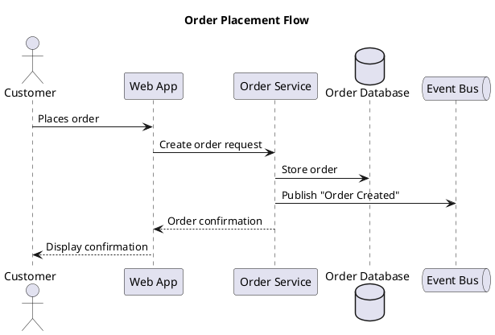

# PlantUML Diagramming

Match the project's existing conventions. Before writing, Glob for `*.puml`, `*.plantuml` and `*.pu`, and read what you find to infer naming, layout direction, theme usage and abstraction level. Check for shared includes (`!include`) or a project theme file. These defaults apply only when the project has no established convention.

## File placement and naming

- Put diagrams in a `diagrams/` directory at the project root, unless the project already has a convention.
- Name files `<context>_<type>_<title>.puml`, lowercase with underscores, for example `auth_sequence_login_flow.puml`.

## Never rules

These are unconditional. They prevent broken or unreadable diagrams regardless of project style.

- **Never omit `@startuml`/`@enduml` delimiters** -- PlantUML silently fails or produces garbage without them. Every `.puml` file must start with `@startuml` and end with `@enduml` (or the equivalent for the diagram type: `@startmindmap`/`@endmindmap`, `@startgantt`/`@endgantt`, etc.).

- **Never use cryptic abbreviations or internal codenames as labels** -- use plain English that any team member understands. `AuthSvc` means nothing to a product manager; `Authentication Service` does. Labels are for humans, not compilers.

- **Never create diagrams with more than ~15 elements without grouping/nesting** -- overcrowded diagrams defeat the purpose. Use `package`, `rectangle`, `node`, `cloud`, or `together` to group related elements. If you cannot group meaningfully, split into multiple diagrams.

- **Never use legacy `skinparam` when `<style>` blocks achieve the same result** -- `skinparam` is deprecated. Use CSS-like `<style>` blocks for all visual customization. The only exception: edge cases where `<style>` does not yet support a specific property -- activity-diagram stereotype coloring (`skinparam activity { BackgroundColor<<x>> ... }`, see `references/activity-diagrams.md`) is the documented one.

- **Never hardcode colors inline on individual elements** -- use stereotype-based `skinparam` or `<style>` blocks for consistency. Inline colors (`#FF0000` or `#CCFFCC` after `;`) on individual elements create maintenance nightmares, visual inconsistency, and often cause syntax errors in activity diagrams.

- **Never mix arrow direction keywords (`-up->`, `-down->`) with layout hacks** -- let PlantUML auto-layout first. Only add direction hints when the auto-layout result is genuinely unreadable. Overriding layout in multiple places creates conflicts that produce worse results than no hints at all.

- **Never use `autonumber` without explicit format** -- bare `autonumber` produces plain integers that add visual noise without aiding comprehension. Use a format string: `autonumber "<b>[000]"` or `autonumber 1 10 "<b>[00]"`.

- **Never omit participant declarations in sequence diagrams** -- undeclared participants render in first-use order, which is deterministic but unstable: adding or reordering a message silently reshuffles the layout. Declare all participants at the top in the order you want them displayed.

- **Never write diagrams without a `title`** -- every diagram needs context for the reader. A diagram without a title is a screenshot without a caption.

## Audience and abstraction level

**Default to high-level, business-friendly diagrams.** The primary audience is non-technical team members and new joiners. Use business-friendly labels, simple relationships, and minimal jargon.

- Use full words: "Payment Service", not "PaySvc" or "pmtSvc"
- Show system boundaries and data flow, not implementation details
- Label arrows with business actions: "submits order", "sends notification"
- Omit method signatures, database column names, and class internals unless explicitly requested

**Only produce detailed/technical diagrams** (class diagrams with methods, database schemas, detailed state machines or sequence flows with method signatures) when the user explicitly asks for a technical, detailed, or low-level diagram. When in doubt, ask.

## Diagram type selection

Load the reference only when you write that type.

| Scenario | Type | Why | Reference |
|----------|------|-----|-----------|
| How systems or services interact over time | Sequence | Shows temporal ordering and message flow | `references/sequence-diagrams.md` |
| High-level system architecture or service boundaries | Component | Shows parts and relationships without temporal ordering | `references/component-deployment.md` |
| Infrastructure and deployment topology | Deployment | Shows nodes and what runs where | `references/component-deployment.md` |
| Business process or workflow with decisions | Activity | Shows branching, parallel paths, and swimlanes | `references/activity-diagrams.md` |
| Object relationships and data modeling (technical) | Class | Shows inheritance, composition, structure; technical audiences only | `references/class-diagrams.md` |
| Lifecycle of a single entity | State | Shows transitions and conditions for one stateful object | `references/state-diagrams.md` |
| Feature scope or user goals | Use Case | Shows actors and what they can do | `references/other-diagram-types.md` |
| Brainstorming or knowledge structure | Mindmap | Non-linear, quick to create | `references/other-diagram-types.md` |
| Project timeline with dependencies | Gantt | Shows scheduling, milestones, critical path | `references/other-diagram-types.md` |
| Work breakdown or deliverable hierarchy | WBS | Shows hierarchical decomposition | `references/other-diagram-types.md` |
| Data relationships (technical) | ER (class with stereotypes) | Shows entities, attributes, cardinality | `references/other-diagram-types.md` |

## Example

A sequence diagram, the most common type, showing the conventions above: a title, all participants declared at the top in display order, and business-friendly labels.

## Styling and preprocessing

Use CSS-like `<style>` blocks placed immediately after `@startuml`, not `skinparam`. Built-in themes load with `!theme` (for example `cerulean` or `plain`), and `left to right direction` suits wide diagrams. See `references/styling.md`.

Split large diagrams or share definitions across files with `!include`. `!procedure`, `!function`, variables, conditionals and loops are also available. See `references/preprocessing.md`.

## Anti-patterns

Soft smells that need contextual judgment (distinct from the unconditional Never rules above):

- **Technical jargon in business-level diagrams** -- `POST /api/v2/orders` belongs in API docs, not in a diagram for stakeholders. Use "Creates order" instead.
- **Mixing styling approaches** -- combining inline colors (`#Red`), `skinparam`, and `<style>` blocks in one file creates conflicting rules and unpredictable rendering. Pick one approach per file; prefer `<style>`.
- **Deep nesting beyond 3 levels in component diagrams** -- deeply nested `package` blocks produce tiny, illegible boxes. Flatten the hierarchy or split into separate diagrams.
- **Using class diagrams when a simpler type suffices** -- showing `Order -> PaymentService` as a class relationship when a component or sequence diagram communicates the same thing more clearly. Choose the simplest diagram type that conveys the information.
- **Duplicating diagram content instead of using `!include`** -- copy-pasted participant declarations and styles across multiple files drift out of sync. Extract shared definitions into include files.
